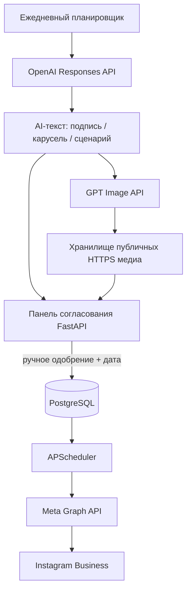

# Instagram AI Content Factory

Python-проект для корпоративного Instagram: AI-генерация текстов и визуалов, очередь согласования, планировщик и публикация через официальный Meta Graph API.

**Важно:** проект не публикует ничего без ручного подтверждения. Нажатие «Одобрить и поставить в очередь» переводит материал в статус `APPROVED`; только затем планировщик может отправить его в Instagram.

## 1. Архитектура



### Стек

- Python 3.12, FastAPI — API и панель согласования.
- OpenAI Responses API (`gpt-6-luna` по умолчанию) — тексты, планирование, сценарии.
- OpenAI Images API (`gpt-image-2.5-flare`) — фоны для одиночных постов, Stories и слайдов каруселей.
- Pillow — наложение читаемого текста на слайды карусели и Stories.
- Runway API (опционально) — генерация вертикального 5-shot Reels по AI-сценарию; готовый файл скачивается в локальное хранилище сразу после генерации.
- FFmpeg — приведение загруженного или сгенерированного видео к вертикальному MP4/H.264/AAC.
- PostgreSQL — публикации и статусы.
- APScheduler — ежедневная генерация черновиков, проверка публикаций каждые 30 секунд и сбор Insights каждые 6 часов.
- Meta Graph API — контейнеры и публикации.

## 2. Что умеет текущая версия

| Формат | AI создаёт | Публикация |
|---|---|---|
| Пост | Подпись, хештеги, визуальный промпт, JPEG | Да |
| Карусель | 5 текстовых слайдов и 5 JPEG-фонов с программно наложенным текстом | Да, 2–10 изображений |
| Reels | Hook, сценарий, сцены, текст диктора; при включённом Runway — вертикальное видео | Да, из автоматически сгенерированного или загруженного MP4/MOV |
| Stories | Заголовок, короткий текст, CTA и вертикальный JPEG с текстовым оверлеем | Да, фото или вертикальное видео MP4/MOV |

### Генерация Reels

По умолчанию AI создаёт сценарий, а оператор загружает MP4/MOV. Для автоматической генерации добавь `RUNWAY_API_KEY` в `.env`: проект вызывает Runway multi-shot video recipe, формирует вертикальное видео 9:16 длительностью 15 секунд, немедленно скачивает временную ссылку в своё хранилище и нормализует MP4 через FFmpeg. Runway generation расходует кредиты/оплачиваемые ресурсы аккаунта; сначала проверь тариф, доступность модели и лимиты в Runway. Выходная ссылка Runway временная, поэтому проект не сохраняет её как конечный URL.

AI также генерирует текст диктора в сценарии. В текущем адаптере Runway используется дорожка автоматически сгенерированного звука, но текст диктора не синтезируется в отдельную озвучку автоматически. Для фирменного дикторского голоса добавляется отдельный TTS-провайдер.

На дату сборки (04.11.2026) OpenAI Videos API и алиасы Sora 2 были выведены из эксплуатации 24.09.2026; поэтому старый Sora API в код не включён. Документация Runway: [Text-to-video / API](https://docs.dev.runwayml.com/api/) и [API output formats](https://docs.dev.runwayml.com/assets/outputs/).


## 3. Требования к Instagram / Meta

1. Instagram должен быть профессиональным аккаунтом типа **Business**.
2. Аккаунт Instagram должен быть связан с Facebook Page.
3. В Meta for Developers создайте приложение типа Business и настройте Instagram API с Facebook Login.
4. Для своего аккаунта получите разрешения как минимум:
   - `pages_show_list`
   - `instagram_basic`
   - `instagram_content_publish`
   - `pages_read_engagement`
   - `instagram_manage_insights` (для сбора статистики)
5. Получите Page Access Token и Instagram Professional Account ID.

Для получения ID и токена в Graph API Explorer после выдачи нужных permissions используется запрос вида:

```http
GET https://graph.facebook.com/v26.0/me/accounts?fields=name,access_token,tasks,instagram_business_account
```

В ответе выберите нужную Page, возьмите её `access_token` и `instagram_business_account.id`.

Документация:
- [Meta for Developers](https://developers.facebook.com/)
- [Instagram API — коллекция Meta в Postman](https://www.postman.com/meta/instagram/documentation/6yqw8pt/instagram-api)
- [Meta — Content Publishing](https://developers.facebook.com/docs/instagram-platform/content-publishing/)
- [Graph API versioning](https://developers.facebook.com/docs/graph-api/changelog/versions/)

Точное название permissions и путь входа могут зависеть от выбранной конфигурации API в Meta Dashboard. Не смешивайте токены Instagram Login и Facebook Login: данный проект написан под Facebook Login (`graph.facebook.com`) и Page Access Token. Доступ к Insights может потребовать отдельного App Review.

## 4. Установка через Docker

### 4.1. Подготовить конфигурацию

```bash
cp .env.example .env
```

Открой `.env` и заполни:

```env
ADMIN_USERNAME=admin
ADMIN_PASSWORD=длинный-случайный-пароль
PUBLIC_BASE_URL=https://social.example.com
OPENAI_API_KEY=...
# Необязательно: ключ Runway для автоматической генерации Reels
RUNWAY_API_KEY=...
META_IG_USER_ID=...
META_PAGE_ACCESS_TOKEN=...
META_API_VERSION=v26.0
```

Задай длинный случайный `POSTGRES_PASSWORD` в `.env`. Не коммить `.env` в Git.

### 4.2. DNS и HTTPS

Meta должна скачать медиафайлы с публичного HTTPS URL. Адрес вида `localhost`, `127.0.0.1` или приватный IP не подойдёт.

Вариант развёртывания:

- VPS с публичным IP.
- DNS `social.example.com` → IP VPS.
- Caddy или Nginx выдаёт TLS-сертификат и проксирует домен на порт 8000.
- `PUBLIC_BASE_URL=https://social.example.com`.

`Caddyfile.example` содержит пример конфигурации. Не открывай PostgreSQL в интернет. В продакшене также рекомендуется закрыть панель через VPN или Cloudflare Access, помимо Basic Auth приложения.

### 4.3. Запуск

```bash
docker compose up --build -d
docker compose logs -f app
```

Открой `https://social.example.com/`. Браузер запросит HTTP Basic Auth: логин и пароль из `.env`.

Проверка:

```bash
curl -u admin:'ТВОЙ_ПАРОЛЬ' https://social.example.com/health
```

## 5. Автоматическая ежедневная генерация

В `.env` укажи профиль компании и включи планировщик:

```env
DAILY_DRAFTS_ENABLED=true
DAILY_DRAFT_COUNT=2
DAILY_GENERATION_HOUR=6
DAILY_GENERATION_MINUTE=0
APP_TIMEZONE=Europe/Paris
BRAND_NAME=Название компании
BRAND_INDUSTRY=Отрасль и продукты
BRAND_AUDIENCE=Описание аудитории
BRAND_TONE=Экспертный, дружелюбный, конкретный
BRAND_OFFER=Только проверенные факты об оффере
DAILY_FORMATS=CAROUSEL,REEL,POST,STORY
```

Рестарт:

```bash
docker compose up -d --build
```

Каждый день в `DAILY_GENERATION_HOUR:DAILY_GENERATION_MINUTE` система запросит у AI контент-план, создаст 2–3 черновика и визуалы для поддерживаемых форматов. Если установлен `RUNWAY_API_KEY` и AI выберет Reels, будет создан и загружен MP4. Все материалы останутся в `DRAFT` — публикация невозможна до твоего одобрения.

Если `RUNWAY_API_KEY` не задан и AI выберет `REEL`, появится сценарий без видео: загрузи MP4/MOV, затем одобри черновик. Даже автоматически сгенерированное Runway видео остаётся черновиком до твоей проверки и одобрения.

## 6. Ручной режим

1. В панели укажи тему, формат, компанию, аудиторию и оффер.
2. Нажми «Сгенерировать черновик».
3. Проверь изображение, подпись, факты и CTA.
4. Для Reels загрузи видео, если не включён Runway; для карусели загрузи дополнительные слайды (AI уже создаёт 5 стартовых).
5. Отредактируй подпись.
6. Выбери дату/время и нажми «Одобрить и поставить в очередь».
7. Планировщик создаст контейнер Instagram, дождётся `FINISHED` и вызовет `media_publish`.
8. Успешные публикации перейдут в `PUBLISHED`; ошибочные — в `FAILED` с текстом ответа API.
9. Через 48 часов планировщик начнёт собирать `views`, `reach` и `total_interactions`; метрики появятся в карточке публикации.

Если дату не указать, публикация будет запущена ближайшим циклом планировщика (обычно до 30 секунд плюс обработка Meta).

## 7. Ключевые ограничения публикации

- Instagram принимает медиа по общедоступному URL; файлы не должны быть за Basic Auth.
- Одиночное изображение и каждый элемент карусели в этом проекте конвертируются в JPEG.
- Карусель: от 2 до 10 изображений.
- Reels: сгенерированное Runway или загруженное видео приводится FFmpeg к вертикальному MP4/H.264 + AAC. Фактические пределы длительности/размера/кодеков всегда сверяйте с актуальными правилами Meta.
- Stories публикация через Facebook Login требует Business-аккаунт; личные аккаунты не поддерживаются.
- Meta может вернуть ошибку разрешений, токена, формата медиа, публикационного лимита или статуса контейнера. Ошибка видна на карточке материала.
- Для Insights требуется `instagram_manage_insights`; метрики могут запаздывать, а набор доступных полей зависит от типа контента. Текущая версия забирает только общий набор `views`, `reach`, `total_interactions`.
- Перед массовым расписанием проверь `content_publishing_limit` в Meta API. Не делай массовые ретраи без анализа причины ошибки.

## 8. Безопасность и эксплуатация

- `.env` содержит секреты — не коммить его и не отправляй никому.
- Используй уникальный длинный `ADMIN_PASSWORD`.
- Используй HTTPS, VPN или Cloudflare Access для панели.
- Токен Meta хранится в переменных окружения, не в базе данных.
- Папка `/media` доступна публично без авторизации, потому что Meta должна скачать файлы. Случайные имена файлов уменьшают риск угадывания, но не заменяют политику хранения.
- Запускай ровно один экземпляр приложения: встроенный APScheduler работает внутри процесса. Для горизонтального масштабирования вынеси планировщик в отдельный worker и добавь распределённую блокировку/очередь.
- Делай бэкапы PostgreSQL и медиа-тома.
- Перед одобрением проверяй факты, права на изображения/видео, музыку, лица, согласия и рекламные обещания.

## 9. Запуск без Docker (для разработки)

Нужен Python 3.12 и FFmpeg в `PATH`.

```bash
python -m venv .venv
source .venv/bin/activate       # Windows: .venv\\Scripts\\activate
pip install -r requirements.txt
cp .env.example .env
# В .env для SQLite: DATABASE_URL=sqlite:///./instagram_ai.db
# MEDIA_DIR=./media и PUBLIC_BASE_URL=https://публичный-домен
uvicorn app.main:app --reload
```

## 10. Тесты и диагностика

```bash
pytest -q
```

Проверить логи:

```bash
docker compose logs --tail=200 app
```

Для отладки публикации сначала используй тестовый бизнес-аккаунт и вручную одобри один JPEG-пост. Затем проверь Stories, карусель и Reels отдельно.

## Профиль @anastasia.content.creator — первичная настройка

В `profile/anastasia_content_creator.json` добавлена стартовая карточка профиля. Это пока **не подтверждённый аудит ленты**: публичная страница Instagram ограничила автоматическое чтение, а поиск по точному username не дал надёжной независимой карточки. Поэтому система настроена как авторский профиль контент-креатора, но ниша, ЦА, оффер, визуальная система и рубрики помечены на подтверждение. Не публикуйте сгенерированные материалы до заполнения этих полей.

После подключения собственного Instagram Business/Creator аккаунта через Meta API можно выгрузить доступные поля профиля и последние 50 публикаций:

```bash
python scripts/audit_connected_instagram.py
```

Скрипт работает только с аккаунтом, который авторизован в вашем приложении Meta. Он не обходит ограничения Instagram и не получает чужие приватные Insights. Для собственных метрик потребуется отдельное разрешение `instagram_manage_insights`.

## GitHub repository setup

See [README_GITHUB.md](README_GITHUB.md) for commands to create a private GitHub repository, commit the project safely, and push the `main` branch. A GitHub Actions workflow runs pytest on pushes and pull requests. Never commit `.env` or API credentials.
